<p align="center">
  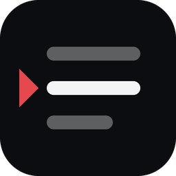
</p>

<h1 align="center">Glass Prompter</h1>

<p align="center">
  <strong>A free teleprompter that runs in your browser, with mirror mode for teleprompter glass.</strong>
</p>

<p align="center">
  Made for the iPad. Works on any phone, tablet or computer with a modern browser.
</p>

<p align="center">
  <a href="https://emaduneme.github.io/glass-prompter/"><strong>Open Glass Prompter</strong></a> · <a href="#features">Features</a> · <a href="#how-it-works">How it works</a> · <a href="#set-it-up-on-an-ipad">iPad setup</a> · <a href="#host-it-yourself">Host it yourself</a> · <a href="#privacy">Privacy</a>
</p>

<p align="center">
  <a href="media/promo.mp4">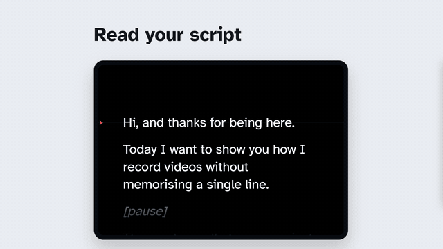</a>
  <br>
  <sub><a href="media/promo.mp4">Watch the 43-second video with sound (MP4)</a></sub>
</p>

---

## What it is

Glass Prompter is a single web page. Paste your script, pick how the text should look, and press Start. The words scroll past a red reading line at the speed you set, so you can read while looking into the camera.

Teleprompter glass reflects the screen, and a reflection reads backwards. Glass Prompter flips the text so the reflection reads the right way round. It flips left to right for standard glass, top to bottom for rigs that mount the screen upside down, or both.

There's nothing to install and no account. The page is one HTML file with no build step. It keeps your script in your own browser.

## Features

### Mirror

| Setting | Use it for |
|---|---|
| **Off** | Reading straight off the screen, without glass. |
| **Horizontal** | Standard teleprompter glass. This is the default. |
| **Vertical** | Rigs that mount the screen upside down. |
| **Both** | Rigs that reflect the screen twice. |

The setup screen shows a small preview of the flip. The control bar on the prompter never mirrors, so you can always read its buttons. Press **M** to cycle the mirror while you're reading.

### Type

| Setting | Options |
|---|---|
| **Typeface** | Sans (Atkinson Hyperlegible), Serif (Source Serif 4), Mono (IBM Plex Mono), Lexend |
| **Text size** | 28 to 140 pt |
| **Text color** | White, yellow, green, cyan, pink |
| **Line width** | Narrow (62%), Medium (80%), Wide (94%) |
| **Alignment** | Left or center |

Words in `[square brackets]` show dimmed and in italics, so you can leave yourself cues like `[pause]` or `[show slide]` without reading them out.

### Motion

- **Scroll speed** from 1 to 15. Speed scales with text size, so bigger text doesn't race past.
- **Reading line** at the top (22%), upper third (34%) or middle (50%) of the screen. Put it close to the lens.
- **3-second countdown** before the text starts, so you have time to look up.
- **Time left** and progress in the control bar, worked out from your current speed.
- **Word count** and reading time on the setup screen, at 150 words a minute.

### Controls while reading

| Action | Touch | Keyboard or Bluetooth remote |
|---|---|---|
| Play or pause | Tap the screen | <kbd>Space</kbd> or <kbd>Enter</kbd> |
| Scroll by hand | Drag up or down | Mouse wheel |
| Jump one line | | <kbd>←</kbd> <kbd>→</kbd> or <kbd>Page Up</kbd> <kbd>Page Down</kbd> |
| Faster or slower | Speed buttons | <kbd>↑</kbd> <kbd>↓</kbd> |
| Bigger or smaller text | Size buttons | <kbd>+</kbd> <kbd>−</kbd> |
| Change the mirror | Mirror button | <kbd>M</kbd> |
| Back to the start | Restart button | <kbd>Home</kbd> |
| Leave the prompter | Close button | <kbd>Esc</kbd> |

The control bar hides itself while the text is moving and comes back when you tap or press a key. Dragging still works when the text is flipped top to bottom; the words follow your finger. Most Bluetooth page-turner remotes send Page Up and Page Down or the arrow keys, so they work without any setup.

### Other details

- Asks the device to keep the screen on while the prompter is open.
- Opens `.txt` and `.md` files.
- Follows your device's light or dark setting on the setup screen.
- Full-screen button on browsers that allow it.

## Screenshots

<table>
  <tr>
    <td width="50%">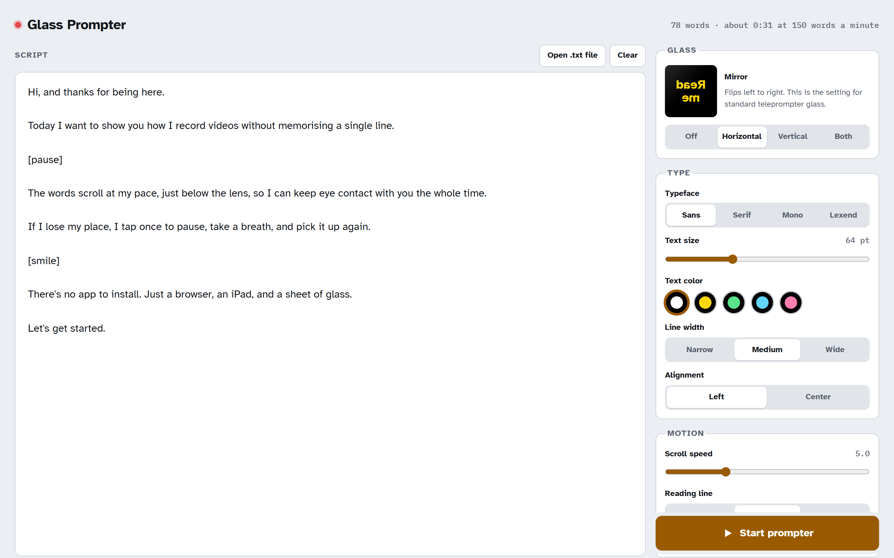</td>
    <td width="50%">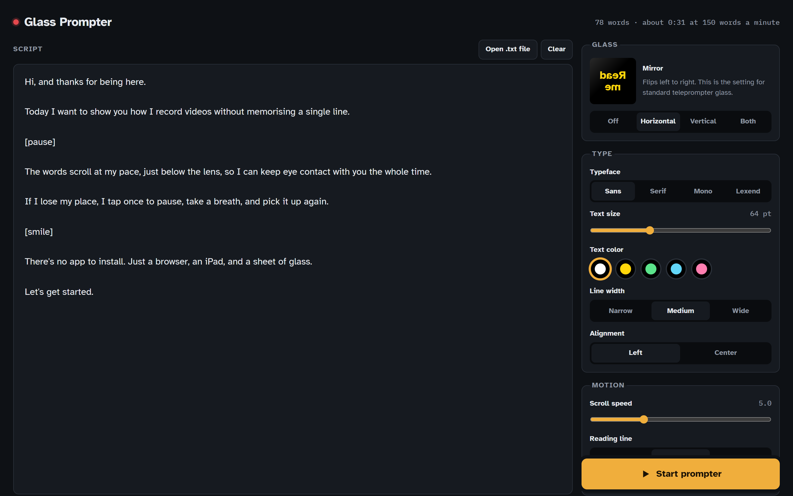</td>
  </tr>
  <tr>
    <td>Setup on a computer, light mode</td>
    <td>Dark mode</td>
  </tr>
  <tr>
    <td>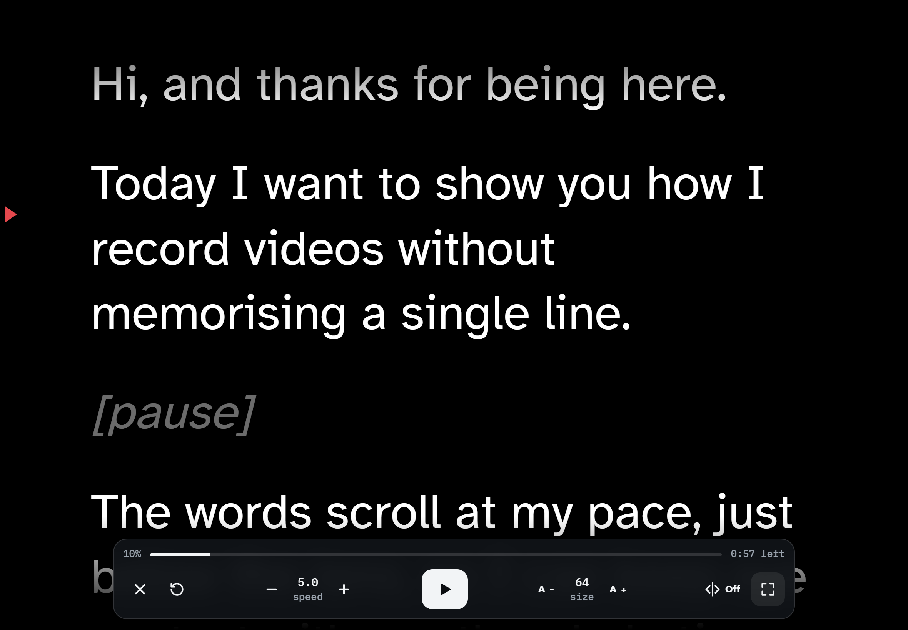</td>
    <td>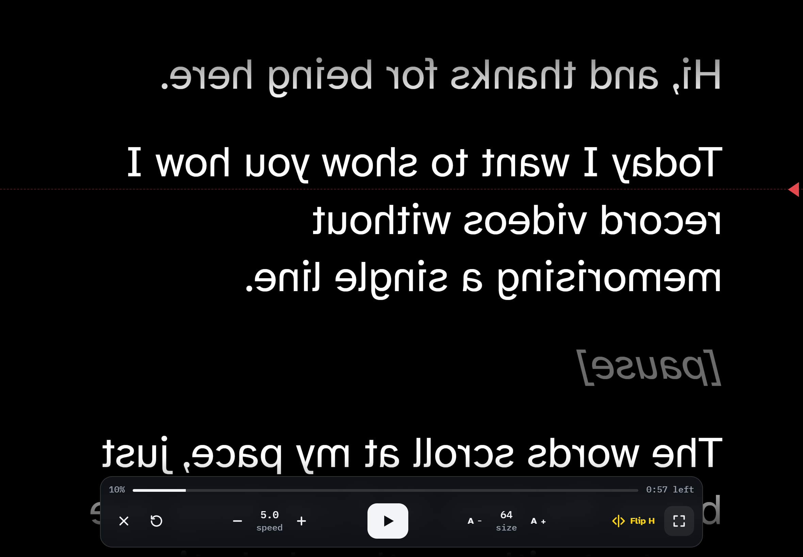</td>
  </tr>
  <tr>
    <td>Prompter on an iPad, mirror off</td>
    <td>Mirrored for glass</td>
  </tr>
  <tr>
    <td>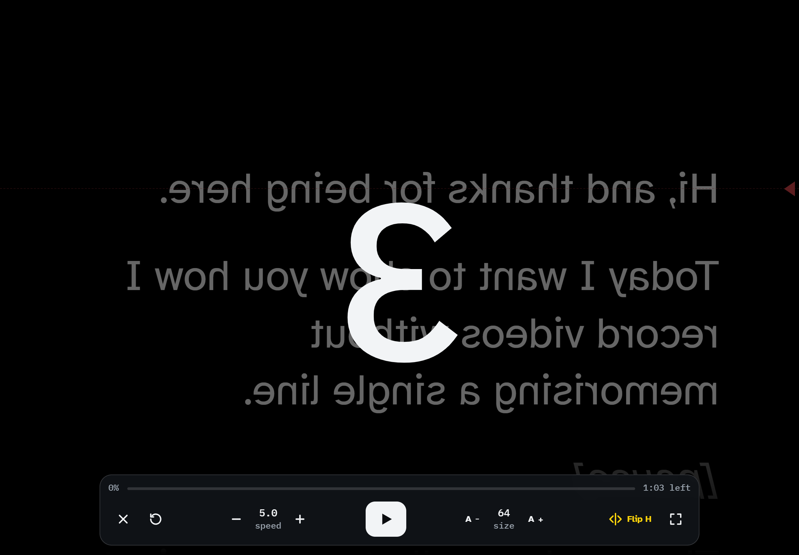</td>
    <td>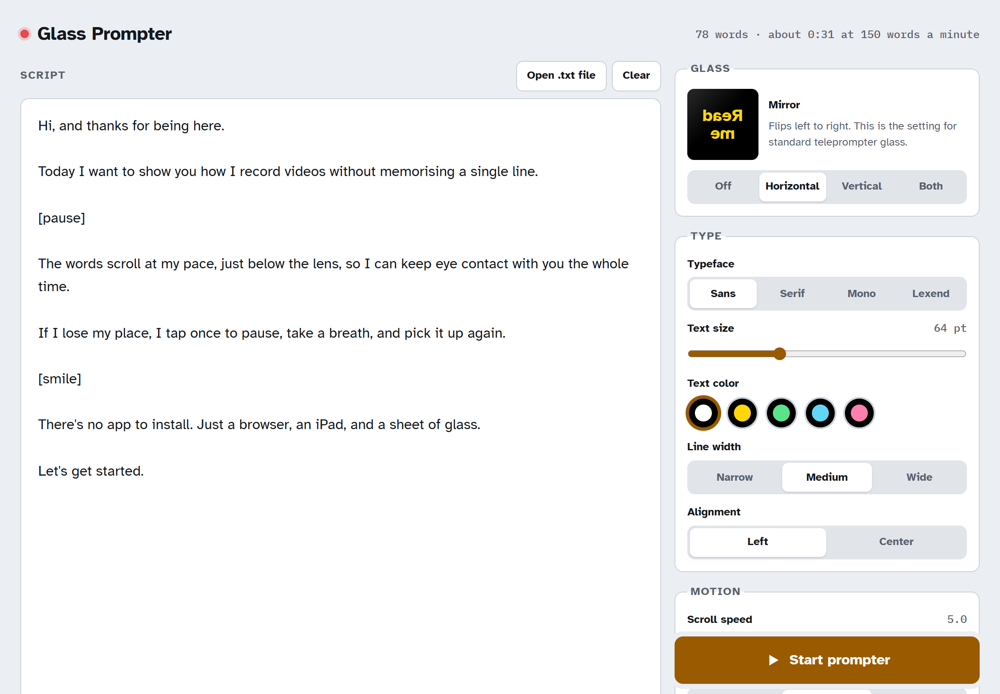</td>
  </tr>
  <tr>
    <td>The 3-2-1 countdown</td>
    <td>Setup on an iPad</td>
  </tr>
</table>

<p align="center">
  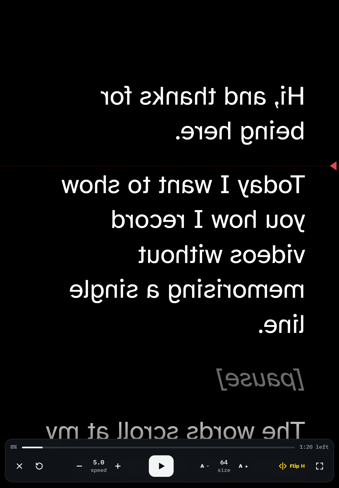
  <br>
  <sub>Portrait works too.</sub>
</p>

<p align="center">
  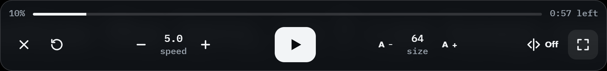
</p>

## Who it's for

| You are | How it helps |
|---|---|
| **A YouTuber or course maker** | Read a full script on camera and keep eye contact with the viewer. |
| **A presenter** | Rehearse and deliver a talk without losing your place. |
| **Anyone with a teleprompter rig** | Turn an iPad you already own into the screen under the glass. |
| **Someone on a video call** | Keep notes right under the webcam, in a size you can read. |

## How it works

1. **Open the page** and paste your script, or open a `.txt` file.
2. **Choose the mirror** for your rig, then set the text size, speed and reading line.
3. **Press Start prompter.** After the countdown, read along with the red marker. Tap to pause whenever you need to.

## Set it up on an iPad

1. Open **[emaduneme.github.io/glass-prompter](https://emaduneme.github.io/glass-prompter/)** in Safari.
2. Tap the **Share** button, then **Add to Home Screen**. Glass Prompter now opens full screen, without Safari's toolbar.
3. Put the iPad in your rig and set **Mirror** to **Horizontal** (or whatever your rig needs).
4. Glass Prompter asks the iPad to keep the screen awake while the prompter is open. If the screen still dims, check **Settings → Display & Brightness → Auto-Lock**.
5. To steer it from across the room, pair a Bluetooth keyboard or page-turner remote with the iPad.

Your script and settings are saved on the iPad, so they're still there next time.

## Remote control (claude.ai version)

There's a second version of Glass Prompter that runs as a Claude artifact on claude.ai. That version adds two modes on top of **On its own**:

- **Remote control**, for your computer: you write and edit there, and a Live panel shows the line the iPad is on, the progress and the time left, with play, pause and line-jump buttons.
- **Display**, for the iPad: it shows the prompter and follows the computer. Settings and script edits arrive live.

<table>
  <tr>
    <td width="50%">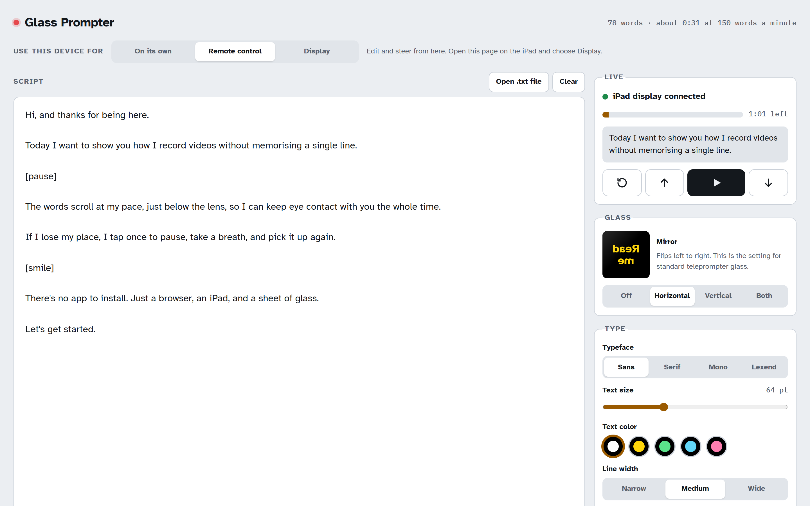</td>
    <td width="50%">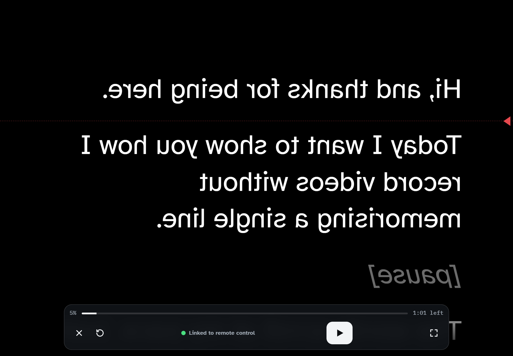</td>
  </tr>
  <tr>
    <td>Remote control on the computer</td>
    <td>Display on the iPad</td>
  </tr>
</table>

The two devices link through claude.ai's shared-room feature, so both need to be signed in to the same Claude account. **This GitHub Pages build doesn't include those two modes,** because a static page has no way to pass messages between devices. They come back here once there's a sync service to connect them.

To try the linked modes on your own machine, serve this folder (see below) and open `tools/linked-test.html?mode=display` in one tab, then `tools/linked-test.html?mode=controller` in a second tab of the same browser. `tools/mock-room.js` stands in for claude.ai and passes messages between the tabs.

## Host it yourself

The whole app is `index.html`. Any static host works.

```bash
git clone https://github.com/emaduneme/glass-prompter.git
cd glass-prompter
python -m http.server 8000
```

Then open `http://localhost:8000`. You can also open `index.html` straight from disk, though some browsers limit the screen wake lock on `file://` pages.

To publish your own copy on GitHub Pages, fork this repository, then go to **Settings → Pages** and deploy from the `main` branch, root folder.

### Project structure

```
index.html          The app: markup, styles and script in one file
media/              Icons, screenshots and the promo video
tools/
├── linked-test.html  Loads the app with the stand-in room, for testing linked modes
└── mock-room.js      BroadcastChannel stand-in for claude.ai's room
```

The page loads its fonts from Google Fonts. Everything else is in the file, with no libraries.

## Privacy

Glass Prompter has no server, no account, no analytics and no ads. Your script and settings are stored in your browser's local storage on that device and never leave it. Clearing your browser data removes them.

The only outside request is to Google Fonts for the typefaces.

## Credits

Inspired by [Textream](https://github.com/f/textream), the free teleprompter for Mac, iPhone and iPad by [Fatih Kadir Akın](https://fka.dev), which is also MIT licensed. Glass Prompter is a separate, browser-only project and shares no code with it.

Typefaces: [Atkinson Hyperlegible](https://www.brailleinstitute.org/freefont/) by the Braille Institute, [Source Serif 4](https://github.com/adobe-fonts/source-serif), [IBM Plex Mono](https://github.com/IBM/plex) and [Lexend](https://www.lexend.com/), all under the SIL Open Font License.

The promo video was made with [HyperFrames](https://hyperframes.heygen.com) from captures of the real app.

Music in the promo video: "Stylish Trailer Percussion" by <a href="https://pixabay.com/users/audioera-23560896/?utm_source=link-attribution&utm_medium=referral&utm_campaign=music&utm_content=622881">Aleh Mikalayeu</a> from <a href="https://pixabay.com//?utm_source=link-attribution&utm_medium=referral&utm_campaign=music&utm_content=622881">Pixabay</a>.

## License

[MIT](LICENSE)
